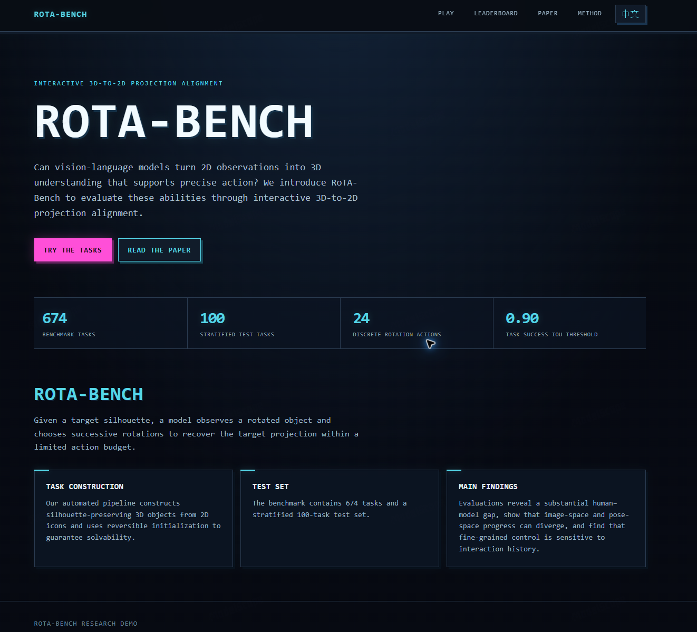

# RoTA-Bench

<p align="center">
  <a href="https://www.modelscope.cn/studios/san2333333/rotabench-anon?mode=full&app_path=%2Fportal"></a>
</p>

<p align="center"><a href="https://www.modelscope.cn/studios/san2333333/rotabench-anon?mode=full&app_path=%2Fportal"><strong>▶ Open the interactive demo</strong></a></p>

<p align="center"><a href="https://github.com/MAC-AutoML/RoTA-Bench"><strong>⌘ Browse the code</strong></a> · <a href="https://arxiv.org/abs/2610.17665v1"><strong>Read the paper</strong></a></p>

Code and the fixed 674-task dataset accompanying **RoTA-Bench: Evaluating 3D Spatial Reasoning through Interactive Projection Alignment**.

The public release contains 674 tasks. Two tasks (`single_00345` and `single_00384`) were removed from the original 676-task collection because their icons could not be redistributed due to copyright restrictions.

**Paper:** [RoTA-Bench: Evaluating 3D Spatial Reasoning through Interactive Projection Alignment](https://arxiv.org/abs/2610.17665v1)<br>
**Authors:** Qingchuan Ma, Yuexiao Ma, Xiang Meng, Yixuan Zou, Tianyu Xie, Wang Chen, Yuhui Zeng, Yuhang Wu, Xiawu Zheng, Rongrong Ji.

## Benchmark Overview

RoTA-Bench evaluates an agent's ability to align a target 2D projection through a sequence of discrete 3D rotations. Each task provides a target silhouette, an auxiliary view of the object, and its current projection. The agent selects from a predefined set of rotation actions and continues until the projected contour aligns with the target.

<p align="center">
  
</p>

*Benchmark overview: interactive observations, rotation actions, projection alignment, and the resulting evaluation signal.*

<p align="center">
  
</p>

*Construction and evaluation pipeline: 3D object generation, reachable reference-path search, frozen task-split construction, and closed-loop agent evaluation.*

The website provides an interactive leaderboard and task browser. This repository contains the evaluation code, task metadata, and fixed dataset for reproducible comparisons.

## Usage

Clone with Git LFS to download the dataset:

```bash
cd RoTA-Bench
pip install -r requirements.txt
```

Install a CUDA-enabled PyTorch build compatible with your NVIDIA driver from https://pytorch.org/get-started/locally/. Formal evaluation and Beam search require CUDA.

Set `OPENAI_API_KEY` to your API key. In Bash use `export OPENAI_API_KEY="your-key"`; in PowerShell use `$env:OPENAI_API_KEY="your-key"`.

Run the frozen 100-task evaluation using an OpenAI-compatible endpoint:

```bash
python src/step_02_test_models.py --backend gemini_api --config data/run_config.json --formal-config src/final_benchmark_config.json --tasks-file data/tasks_674.jsonl --split-file data/test_100.json --base-url https://YOUR-ENDPOINT/v1 --api-model YOUR-MODEL --model-name YOUR-MODEL --metric-feedback-mode none --max-step-cap 48 --output-dir result/evaluation
```

To regenerate tasks from the original 2D icons, install the additional `cairosvg` dependency and run `src/step_01_generate_data.py`. The script downloads the upstream [game-icons](https://github.com/game-icons/icons) SVG repository when `data_sources/game-icons` is absent, rasterizes each SVG into deterministic 2D points, applies the icon-quality filters, constructs the spherical 3D geometry, renders the target and initial views, and writes task JSONL records. The game-icons assets remain under their upstream Creative Commons/public-domain licenses; review `data_sources/game-icons/license.txt` and the upstream attribution requirements before redistributing them.

```bash
python src/step_01_generate_data.py --root . --config data/run_config.json --sample-count 1 --save-target-images --save-init-images --save-init-oblique-images --no-resume
```

Run Beam-256 reference search:

```bash
python src/guided_iou_beam.py --tasks-file data/tasks_674.jsonl --beam-widths 256 --output-dir result/beam256
```

Use `--help` for additional options. The 100-task test IDs, remaining 574-task IDs, and saved Beam/BFS paths are in `data/`.

## Task Example

`single_00627`: target projection, current auxiliary view, and current projection.


The left panel shows the target silhouette, the middle panel shows the current 3D object, and the right panel shows its current projection. A successful trajectory aligns the current projection with the target while minimizing the number of rotation steps.

## Interactive Results and Resources

The accompanying website provides interactive leaderboard tables and cost–performance plots. Hover over a point to inspect the model, benchmark split, and metric values. Use the task browser to replay individual trajectories.

## Online demo

[Open the interactive demo](https://www.modelscope.cn/studios/san2333333/rotabench-anon?mode=full&app_path=%2Fportal) — powered by a free CPU Studio on ModelScope.
